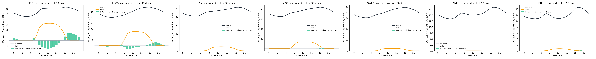

# grid-pulse ⚡ U.S. grid & battery-storage data pipeline

An automated ETL pipeline that pulls hourly U.S. electricity data (demand, day-ahead forecast and generation by fuel, including battery storage) from the **EIA Open Data API**, validates it with data-quality gates, loads it into SQL with idempotent upserts, flags anomalies, estimates grid carbon intensity, and publishes a self-updating interactive dashboard on how batteries cover solar's evening drop-off in **California (CAISO)** and **Texas (ERCOT)**.

**[▶ Live dashboard](https://autkarsh025.github.io/grid-pulse/)** · 

<!-- After your first real run, put your best chart here: -->
<!--  -->

---

## Architecture

```
 EIA API v2 ──► extract.py ──► data/raw/*.json        (as received; replayable)
                                   │
                              transform.py            (pandas: UTC timestamps, types, dedupe)
                                   │
                              quality.py  ── FAIL ──► run logged as failed, nothing loaded
                                   │ pass
                              load.py ──► SQLite      (composite keys + upserts = idempotent)
                                   │
                              anomalies.py            (robust z-score spikes/drops, flatlines)
                              carbon.py               (hourly CO2 intensity, battery CO2 shift)
                                   │
              sql/analysis/*.sql ──► charts + docs/index.html dashboard

 Scheduling: Airflow DAG (dags/) or GitHub Actions daily cron (.github/workflows/daily.yml)
 Alerting:   a failed scheduled run automatically opens a GitHub issue
```

## Tech stack

Python · pandas · SQL (SQLite) · Airflow · GitHub Actions · pytest · Plotly.js · matplotlib

## Quick start

```bash
git clone https://github.com/autkarsh025/grid-pulse.git && cd grid-pulse
python -m venv .venv && source .venv/bin/activate      # Windows: .venv\Scripts\activate
pip install -r requirements.txt
cp .env.example .env                                   # then paste your free EIA key into .env

pytest -q                                              # 38 tests, no API key needed
python -m src.pipeline --start 2025-11-01 --end 2026-11-20   # backfill ~12 months
python -m analysis.run_analysis                        # SQL analyses -> charts in docs/img/
python -m analysis.build_dashboard                     # interactive dashboard -> docs/index.html
```

A GitHub Actions job runs the pipeline every morning and commits the refreshed dashboard, so the live page updates itself. Daily runs locally: `python -m src.pipeline` (defaults to yesterday, UTC). Re-run transform/load from saved raw files without calling the API: add `--from-raw`.

## Design decisions

**Idempotent loads.** Every table has a composite primary key (`region_code, period_utc[, fuel_type]`), and loads use `INSERT … ON CONFLICT DO UPDATE`. Re-running any day, or overlapping a backfill, never creates duplicates, and EIA's revisions overwrite older values. Each batch loads in one transaction, so it lands completely or not at all.

**Everything in UTC.** In local time, daylight-saving days have 23 or 25 hours, which creates gaps and duplicate timestamps. In UTC every day has exactly 24 hours, so completeness checks are simple. Local time is used only for analysis.

**Quality gate before load.** `quality.py` checks each batch before it touches the database: non-empty, unique keys, null share ≤ 2%, ≥ 95% of expected hours present, demand within sane ranges, and solar near zero at night (warning). Freshness is checked after scheduled runs. Failures stop the run and are recorded in `pipeline_runs`. Bad values are flagged, never silently filled.

**Anomaly detection.** Each hourly value is compared with the same local hour over the previous 28 days using a robust z-score (median and MAD, so one bad day can't distort the baseline). A non-zero reading stuck for 8+ hours is flagged as a flatline, which often means a frozen sensor or a stale feed.

**Every grid reports differently.** ERCOT publishes batteries as `BAT`; CAISO has no `BAT` code at all. A data-profiling step (`python -m analysis.run_analysis`) showed CAISO's `OTH` ("Other") swinging from about −7 GW at noon to +5 GW at 7pm, which is the signature of its battery fleet charging on solar and discharging at night. So the transform maps CAISO `OTH` → `BAT` (`config.FUEL_CODE_OVERRIDES`), with the caveat that it includes a small amount of other generation.

**Net peak, not gross peak.** Batteries don't target the hour of highest demand. They target the highest *net* load (demand minus solar and wind), the hard hour after sunset. `sql/analysis/06_net_peak_battery_share.sql` measures battery share at each day's net peak.

**Carbon intensity.** Each hour's grid intensity is generation-weighted CO₂ per MWh, using EIA's average emission rates for coal and gas (`src/config.py`). Batteries are excluded from the mix, since they re-deliver energy rather than make it. The battery "CO₂ shift" compares the intensity of the hours when batteries charge with the hours when they discharge. This uses average, not marginal, intensity: a deliberate, documented simplification.

**Alerting.** If the daily run fails, the workflow opens a GitHub issue with a link to the logs, or comments on the existing one, so a broken pipeline never fails silently.

**Raw data kept.** API responses are saved untouched before transforming, so a transform bug can be fixed and replayed without re-downloading.

## Findings

<!-- Fill these in from `python -m analysis.run_analysis` output. Use only real numbers from your data. -->
1. **Battery growth:** _…_
2. **Duck curve:** _…_
3. **Net-peak coverage:** _…_
4. **Carbon:** _…_

## Repo layout

```
src/        extract, transform, quality, load, anomalies, carbon, pipeline (CLI), config
sql/        schema.sql + analysis queries (CTEs, window functions)
dags/       Airflow DAG: extract >> transform >> quality >> load >> detect_anomalies
analysis/   charts and dashboard builder
tests/      pytest: transform, quality, load idempotency, anomalies, carbon, end-to-end with mocked API
docs/       dashboard (served by GitHub Pages) and chart images
```

## What I'd add next

- Postgres in Docker, with partitioning by month
- Weather data (temperature) to explain demand spikes
- Incremental anomaly scoring instead of a full rebuild
- At larger scale: object storage for raw data (S3/Parquet), Spark or a warehouse for transforms, streaming ingestion

---
Data: U.S. Energy Information Administration, Hourly Electric Grid Monitor (EIA-930), via the EIA Open Data API v2.
